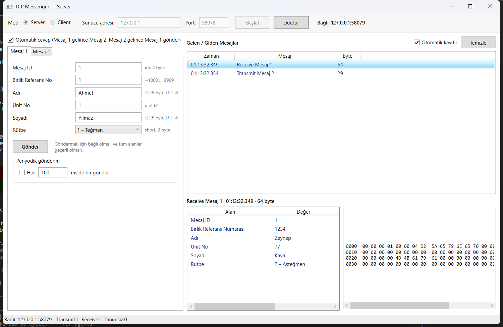

# TcpMessenger

[](https://github.com/atakanerkus/tcp-messenger/actions/workflows/ci.yml)

İki sabit yerleşimli binary mesajı TCP/IP üzerinden gönderip alan, **server veya client** olarak çalışabilen WPF masaüstü uygulaması. Yazılım test mühendisliği mülakat görevinin 4. sorusuna cevap olarak geliştirilmiştir; görev gereği aynı makinede bir server bir client instance çalıştırılarak canlı gösterilir.



## Özellikler

| Gereksinim | Uygulamadaki karşılığı |
|---|---|
| Server veya client modu | Üst panelde mod seçimi, **Başlat / Bağlan**, **Durdur**, durum satırı |
| Mesaj alanlarının girilip gönderilmesi | Mesaj 1 / Mesaj 2 sekmeleri; her alan görev tablosundaki aralığa göre anlık doğrulanır, geçersizken **Gönder** pasif |
| Zaman + yön + mesaj adı ile liste | `Transmit` / `Receive` ön ekli, ms hassasiyetli trafik listesi; durum çubuğunda sayaçlar |
| Seçilen mesajın içeriği | Alt panelde alan tablosu (geçersiz alanlar işaretli) ve ham hex dökümü |
| Otomatik cevap (1 → 2, 2 → 1) | Anahtarla açılıp kapanır, varsayılan açık; cevap formdaki güncel değerlerle gönderilir |
| Tanımsız mesaj uyarısı | Sarı uyarı bandı + listede kırmızı `Receive Tanımsız (…)` satırı; modal pencere yok |
| Periyodik gönderim | Mesaj tipi başına "Her N ms" anahtarı (ör. Mesaj 1 100 ms, Mesaj 2 500 ms aynı anda) |

Komut satırı ön ayarları demo ve testleri kolaylaştırır (hiçbir şey otomatik başlatılmaz):

```
TcpMessenger.App.exe --mode server --port 5000 --autoreply on
TcpMessenger.App.exe --mode client --host 127.0.0.1 --port 5000 --autoreply off
```

Visual Studio'da aynı ön ayarlar `Server` ve `Client` başlatma profilleri olarak hazırdır (`src/TcpMessenger.App/Properties/launchSettings.json`). Başlangıç projesi `TcpMessenger.App` iken araç çubuğundan **Server** seçilip **Ctrl+F5**, ardından **Client** seçilip yeniden **Ctrl+F5** ile iki pencere açılır.

## Mimari

```
┌───────────────────┐
│ TcpMessenger.App  │  WPF, MVVM (CommunityToolkit.Mvvm) — yalnızca Core'a bağımlı
└─────────┬─────────┘
          ▼
┌───────────────────┐
│ TcpMessenger.Core │  MessengerSession, AutoReplyPolicy, PeriodicSender, TrafficLog
└───┬───────────┬───┘
    ▼           ▼
┌─────────┐ ┌───────────┐
│Protocol │ │ Transport │  Protocol: mesajlar, binary codec, framing, doğrulama (soket yok)
└─────────┘ └───────────┘  Transport: TcpConnection / TcpServerTransport / TcpClientTransport (yalnızca byte)
```

- Her projede arayüzler **`Abstractions/`** klasöründedir; üst katmanlar ve testlerdeki sahte nesneler yalnızca arayüzlere bağımlıdır.
- Alma hattı: `IConnection` byte'ları → `FrameParser` (ID'den sabit uzunluk) → `BinaryMessageCodec` → `MessageValidator` → `TrafficLog` → `AutoReplyPolicy`.
- Arayüz doğrulaması Protocol'deki `MessageValidator`'ı yeniden kullanır; aralık kuralları tek yerde yaşar.

Ayrıntılar: [docs/protocol.md](docs/protocol.md) (byte yerleşimleri), [docs/decisions.md](docs/decisions.md) (K1–K13 tasarım kararları), [docs/demo-script.md](docs/demo-script.md) (sunum akışı).

## Testler

```
tests/TcpMessenger.Tests/
├── unit/          Protocol (byte vektörleri, sınır değerleri, parçalı akış), Core (sahte bağlantı + FakeTimeProvider), App (ViewModel'ler)
├── integration/   gerçek loopback TCP: Transport, iki tam Core yığını (otomatik cevap, ping-pong, ham byte, periyodik)
├── e2e/           FlaUI ile iki gerçek pencere: bağlan, gönder, otomatik cevap, detay + hex, tanımsız mesaj, periyodik, kopma
└── TestUtilities/ sahteler (FakeConnection, FakeMessengerSession, …) ve yardımcılar
```

| Kategori | Adet | Komut | CI |
|---|---:|---|---|
| Unit | 206 | `dotnet test --filter Category=Unit` | ✔ |
| Integration | 25 | `dotnet test --filter Category=Integration` | ✔ |
| E2E | 7 | `dotnet test --filter Category=E2E` | yalnızca lokal (etkileşimli masaüstü gerekir) |

## Derleme ve çalıştırma

Gereksinimler: .NET SDK 10.0, Windows 10/11.

```bash
dotnet build TcpMessenger.slnx
dotnet run --project src/TcpMessenger.App -- --mode server --port 5000
dotnet run --project src/TcpMessenger.App -- --mode client --host 127.0.0.1 --port 5000 --autoreply off
```

Runtime bağımsız tek dosya:

```bash
dotnet publish src/TcpMessenger.App -c Release -r win-x64 --self-contained -p:PublishSingleFile=true -o publish/win-x64
```

## Depo düzeni

```
├── .github/workflows/ci.yml    build + unit/integration (windows-latest)
├── docs/                       protokol, kararlar, demo senaryosu, ekran görüntüleri
├── src/                        Protocol · Transport · Core · App
├── tests/TcpMessenger.Tests/   unit/ · integration/ · e2e/ · TestUtilities/
├── Directory.Build.props       warnings-as-errors, analyzer'lar, build'de kod stili
├── Directory.Packages.props    merkezi NuGet sürümleri
└── TcpMessenger.slnx
```

## Görev tanımındaki açık noktalar

Görev metni bazı noktaları açık bırakır; alınan kararlar [docs/decisions.md](docs/decisions.md) içinde gerekçeleriyle yazılıdır. En önemlisi **K4**: otomatik cevap iki tarafta da açıkken tek bir mesaj sonsuz Mesaj 1 ↔ Mesaj 2 döngüsü başlatır; bu yüzden özellik kullanıcı anahtarına bağlanmıştır ve davranış bir integration testiyle belgelenmiştir.
